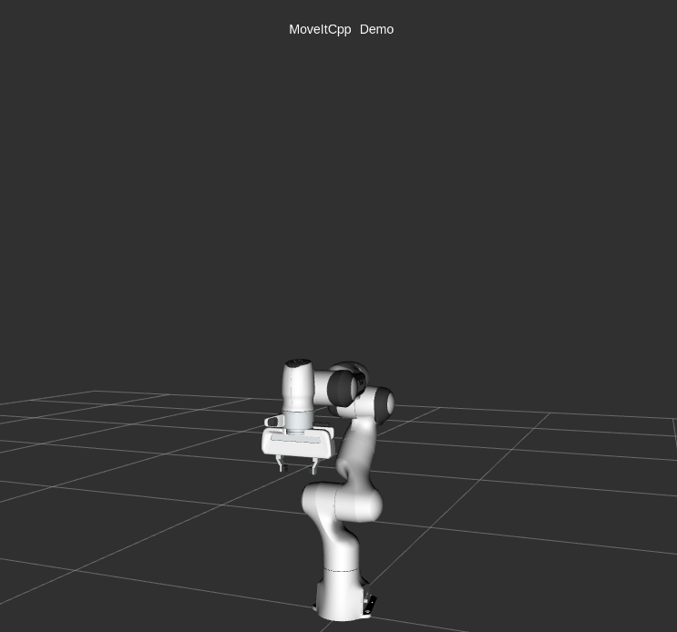

MoveItCpp Tutorial
==================================

Introduction
------------
MoveItCpp is a new high level interface, a unified C++ API that does not require the use of ROS Actions, Services, and Messages to access the core MoveIt functionality, and an alternative (not a full replacement) for the existing :doc:`MoveGroup API </doc/examples/move_group_interface/move_group_interface_tutorial>`, we recommend this interface for advanced users needing more realtime control or for industry applications. This interface has been developed at PickNik Robotics by necessity for our many commercial applications.

Getting Started
---------------
If you haven't already done so, make sure you've completed the steps in :doc:`Getting Started </doc/tutorials/getting_started/getting_started>`.

Running the Code
----------------
Open a shell, run the launch file: ::

  ros2 launch moveit2_tutorials moveit_cpp_tutorial.launch.py

After a short moment, the RViz window should appear and look similar to the one at the top of this page. To progress through each demo step either press the **Next** button in the **RvizVisualToolsGui** panel at the bottom of the screen or select **Key Tool** in the **Tools** panel at the top of the screen and then press **0** on your keyboard while RViz is focused.

The Entire Code
---------------
The entire code can be seen :codedir:`here in the MoveIt GitHub project<examples/moveit_cpp/src/moveit_cpp_tutorial.cpp >`. Next we step through the code piece by piece to explain its functionality.

.. tutorial-formatter:: ./src/moveit_cpp_tutorial.cpp

The Launch File
---------------
The entire launch file is :codedir:`here<examples/moveit_cpp/launch/moveit_cpp_tutorial.launch.py>` on GitHub.
Notably, the launch file contains the following node

.. code-block:: python

    # MoveItCpp demo executable
    moveit_cpp_node = Node(
        name="moveit_cpp_tutorial",
        package="moveit2_tutorials",
        executable="moveit_cpp_tutorial",
        output="screen",
        parameters=[moveit_config.to_dict()],
    )

This node contains parameters which are passed to the executable associated with ``moveit_cpp_tutorial``.

The ``CMakeLists.txt`` File
----------------------------
During the build process, the ``CMakeLists.txt`` file assigns where the launch file will look for the executable.
Below is the ``CMakeLists.txt`` file for this tutorial:

.. literalinclude:: ./CMakeLists.txt
   :language: cmake

``find_package`` locates ``moveit_visual_tools`` (other common dependencies are found in the ``moveit2_tutorials`` root ``CMakeLists.txt`` file).

``add_executable`` builds the executable named ``moveit_cpp_tutorial`` from the source file ``src/moveit_cpp_tutorial.cpp``.

``target_include_directories`` specifies the directories to search for header files during compilation.
``PUBLIC`` makes the include directory available to targets that depend on ``moveit_cpp_tutorial``.

``target_link_libraries`` specifies the libraries (``moveit_ros_planning::moveit_cpp`` and ``moveit_visual_tools::moveit_visual_tools``) to link into the ``moveit_cpp_tutorial`` executable.

``install(TARGETS ...)`` and ``install(DIRECTORY ...)`` specify where to put the built executable and directories needed to run your program.

For more details about building executables in ROS packages, please browse the other examples on this site as well as the `ROS 2 documentation <https://docs.ros.org/en/{DISTRO}/Tutorials.html>`_.
