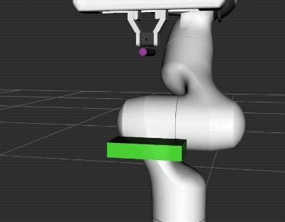

Subframes
============================

Subframes are frames that are defined on CollisionObjects. They can be used to define frames of interests on objects that you place in the scene,
such as the opening of a bottle, the tip of a screwdriver, or the head of a screw. They can be used for planning: After attaching an object to your robot,
you can set the pose goal of a MotionPlanRequest in the frame of the Subframe (note that you may may not do this via MoveGroupInterface yet).

Look at the colorful coordinate axes of the box and the cylinder in the GIF above. These are subframes of the collision objects,
so you can do things like this:

.. code-block:: c++

  move_group.setPoseTarget(target_pose, "cylinder/tip");

In this animation, the robot moves the tip of the cylinder to different positions on the box.

Getting Started
---------------
If you haven't already done so, make sure you've completed the steps in :doc:`Getting Started </doc/tutorials/getting_started/getting_started>`.

**Note:** This tutoral has made use of xterm and a simple prompter to help the user choose from each demo option.
To install xterm please run the following command: ::

   sudo apt-get install -y xterm

Running The Demo
----------------
After having completed the steps in :doc:`Getting Started </doc/tutorials/getting_started/getting_started>`, open two terminals. In the first terminal, execute this command to load up a panda, and wait for everything to finish loading: ::

   ros2 launch moveit_resources_panda_moveit_config demo.launch.py

In the second terminal run the tutorial: ::

   ros2 launch moveit2_tutorials subframes_tutorial.launch.py

In this terminal you should be able to enter numbers from 1-12 to send commands, and to see how the robot and the scene react.

The Code
---------------
The code for this example can be seen :codedir:`here <examples/subframes>` in the moveit2_tutorials GitHub project and is explained in detail below.

The code spawns a box and a cylinder in the planning scene, attaches the cylinder to the
robot, and then lets you send motion commands via the command line. It also defines two
convenience functions closely following the implementation of the original tutorial.

.. tutorial-formatter:: ./src/subframes_tutorial.cpp

Technical notes
---------------
Subframes are not known to TF, so they cannot be used outside of MoveIt planning requests.
If you need the transformation to a subframe, you can obtain it from the ``PlanningScene``'s
``CollisionRobot`` using the ``getFrameTransform`` function. This returns an ``Eigen::Isometry3d`` object,
from which you can extract translation and quaternion (see `here <https://eigen.tuxfamily.org/dox/group__TutorialGeometry.html>`_).
The translation and quaternion can then be used to create the Transform and register it in your ``TFListener``.

Visualizing subframes
---------------------
Notice that you cannot see the subframes of the objects in RViz unless you delete and disable and reenable the PlanningScene plugin in RViz. After
performing those actions on the PlanningScene plugin, the PlanningScene tab should be configured with the ``Show Subframes`` box ticked.

Troubleshooting
---------------
For older moveit_config packages that you have not generated yourself recently, the PlanningAdapter
required for subframes might not be configured, and the subframe link might not be found. To fix this for your
moveit_config package, open the ``ompl_planning_pipeline.launch`` file in the ``<robot_moveit_config>/launch``
folder of your robot. For the Panda robot it is :panda_codedir:`this <launch/ompl_planning_pipeline.launch.xml>` file.
Edit this launch file, find the lines where ``ompl_planning_pipeline_config`` is mentioned and insert ``default_planner_request_adapters/ResolveConstraintFrames`` after
the line ``default_planner_request_adapters/FixStartStatePathConstraints``.
